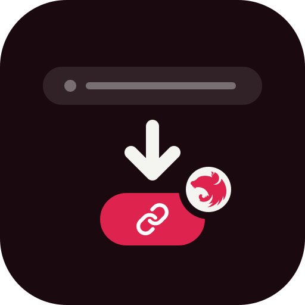
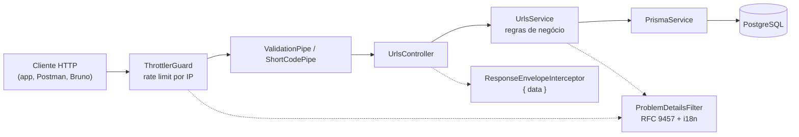
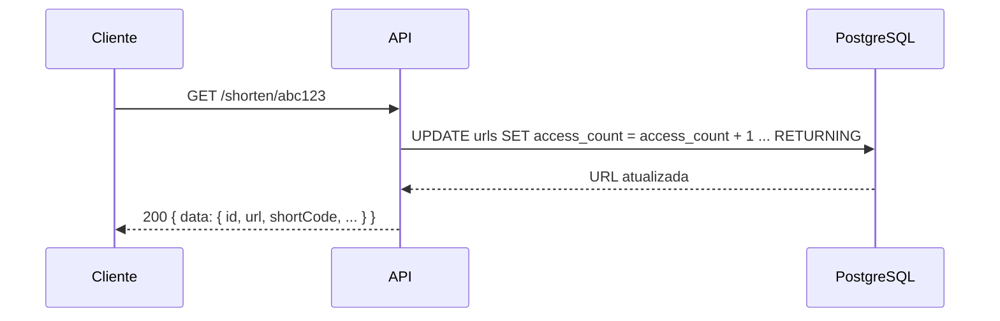

<p align="center">
  
</p>

<h1 align="center">URL Shortener — API</h1>

<p align="center">
  API REST que encurta URLs longas em códigos curtos e conta quantas vezes cada um é acessado.
</p>

## Sobre

O cliente envia uma URL e recebe um `shortCode` aleatório de 6 caracteres. Com esse código, dá para recuperar a URL original (cada consulta conta um acesso), atualizá-la, excluí-la e ver as estatísticas. Os dados ficam no PostgreSQL, e as respostas seguem um contrato único: `{ "data": ... }` no sucesso e Problem Details (RFC 9457) no erro, em pt-BR ou en.

Baseado no desafio [roadmap.sh — URL Shortening Service](https://roadmap.sh/projects/url-shortening-service).

**Tecnologias:** `Node.js` · `TypeScript` · `NestJS` · `Prisma` · `PostgreSQL` · `Docker` · `Vitest`

## Arquitetura





Outros fluxos (criação, colisão de código, 404, rate limit) em [Diagramas de sequência](docs/diagramas/sequencia.md).

## Endpoints

| Método   | Rota                   | O que faz                                       |
| -------- | ---------------------- | ----------------------------------------------- |
| `GET`    | `/health`              | Verifica o estado da API e do PostgreSQL        |
| `POST`   | `/shorten`             | Encurta uma URL (`201`)                         |
| `GET`    | `/shorten/:code`       | Recupera a URL original e conta um acesso       |
| `PUT`    | `/shorten/:code`       | Atualiza a URL mantendo o código                |
| `DELETE` | `/shorten/:code`       | Exclui a URL (`204`)                            |
| `GET`    | `/shorten/:code/stats` | Estatísticas (`accessCount`), sem contar acesso |

> Rate limit de 100 requisições por minuto por IP (configurável), `url` com até 2048 caracteres e corpo com até 100 kB. Para parâmetros, respostas e erros, consulte a [documentação OpenAPI/Swagger](http://localhost:3000/docs) com a app rodando, ou a página [API](docs/api.md). Collections prontas em `collections/` (Postman e Bruno).

## Como executar

Requisitos: Node.js 24+, pnpm 12+ e Docker.

```bash
cp .env.example .env
pnpm install
pnpm db:up                  # PostgreSQL de desenvolvimento (Docker)
pnpm db:migrate:deploy      # aplica as migrations
pnpm start:dev
```

> API em <http://localhost:3000>, Swagger em <http://localhost:3000/docs>. Testes de integração e E2E: `pnpm test:docker`. Todos os scripts em [Testes e comandos](docs/testes.md#todos-os-scripts).

## Documentação

| Página                                                | O que tem                                                |
| ----------------------------------------------------- | -------------------------------------------------------- |
| [Requisitos](docs/requisitos.md)                      | Escopo e regras do desafio                               |
| [Stack](docs/stack.md)                                | Tecnologias, versões e responsabilidades                 |
| [Arquitetura](docs/arquitetura.md)                    | Módulos, DI, fluxo das respostas e i18n                  |
| [Configuração](docs/configuracao.md)                  | Variáveis de ambiente, Prisma e banco de desenvolvimento |
| [API](docs/api.md)                                    | Rotas, contratos, limites e exemplos                     |
| [Testes e comandos](docs/testes.md)                   | Tipos de teste, matriz por endpoint e scripts            |
| [CI e releases](docs/CI.md)                           | Pipelines, CHANGELOG e versionamento                     |
| [Modelo de dados](docs/diagramas/modelo-de-dados.md)  | Tabela `urls`, colunas e migrations                      |
| [Diagramas de sequência](docs/diagramas/sequencia.md) | Fluxos principais e requisições                          |
| [ADRs](docs/adr/README.md)                            | Registro de decisões importantes                         |

## Referências

- [NestJS — Documentation](https://docs.nestjs.com/)
- [NestJS — OpenAPI / Swagger](https://docs.nestjs.com/openapi/introduction)
- [NestJS — Rate limiting](https://docs.nestjs.com/security/rate-limiting)
- [Prisma — Documentation](https://www.prisma.io/docs)
- [PostgreSQL — Documentation](https://www.postgresql.org/docs/)
- [Vitest — Guide](https://vitest.dev/guide/)
- [RFC 9457 — Problem Details](https://www.rfc-editor.org/rfc/rfc9457)
- [Mermaid — Diagramas](https://mermaid.js.org/intro/)
- [Projeto no Linear](https://linear.app/url-shortener-pj/project/nestjs-url-shortener-6a6d5cc95155)
