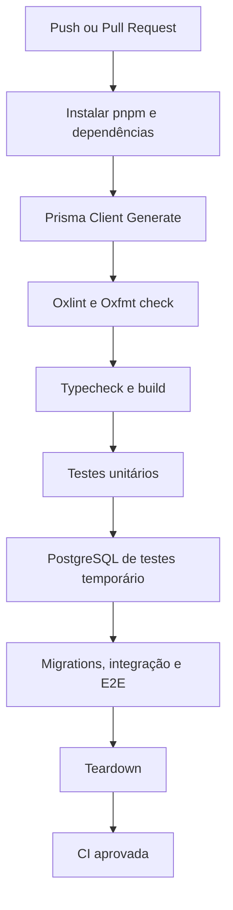

# CI e releases

```text
.github/
└── workflows/
    ├── ci.yml       # push e pull request          (v0.5.0)
    └── release.yml  # somente workflow_dispatch    (v0.5.0)
```

## `ci.yml` — automático



Jobs podem rodar em paralelo, desde que não compartilhem o mesmo banco temporário de forma insegura. `test:docker` cuida da criação, preparo e limpeza do banco.

## `release.yml` — manual (**Run workflow**)

Disparado apenas por `workflow_dispatch`, com entradas `version` (ex.: `v0.1.0`) e `prerelease` (boolean), e `concurrency: manual-release`.

1. **Actions → Release → Run workflow** na branch `main`.
2. Validar que roda na `main` e que a versão segue SemVer.
3. Recusar se a tag já existir; comparar com `package.json` e exigir seção correspondente no `CHANGELOG.md`.
4. Executar os mesmos checks da CI.
5. Em caso de falha, **não** criar tag nem Release.
6. Com tudo verde, criar a tag no commit validado e a GitHub Release (`gh release create`, `GITHUB_TOKEN`, `contents: write`).
7. `pre-release` opcional; notas a partir do changelog ou geradas pelo GitHub.

Criar milestone no Linear ou dar merge na `main` **não** dispara release. Deploy não faz parte do projeto inicialmente.

## Versionamento

- [Semantic Versioning](https://semver.org/lang/pt-BR/): `MAJOR.MINOR.PATCH`.
- [Keep a Changelog](https://keepachangelog.com/pt-BR/1.1.0/): `CHANGELOG.md`.
- Tags `vX.Y.Z` e GitHub Releases somente após validação e comando manual.

## Milestones

| Versão   | Objetivo                                                                     |
| -------- | ---------------------------------------------------------------------------- |
| `v0.1.0` | Inicialização, pnpm, OXC, editores, configuração, Swagger e esqueleto Vitest |
| `v0.2.0` | PostgreSQL, Prisma, migrations e bancos de testes                            |
| `v0.3.0` | CRUD (`POST`, `GET`, `PUT`, `DELETE`) e testes                               |
| `v0.4.0` | Estatísticas, contagem, interceptors e Problem Details                       |
| `v0.5.0` | Integração/E2E, 1–4 workers, collections e GitHub Actions                    |
| `v1.0.0` | API revisada, testes verdes, documentação e release estável                  |
