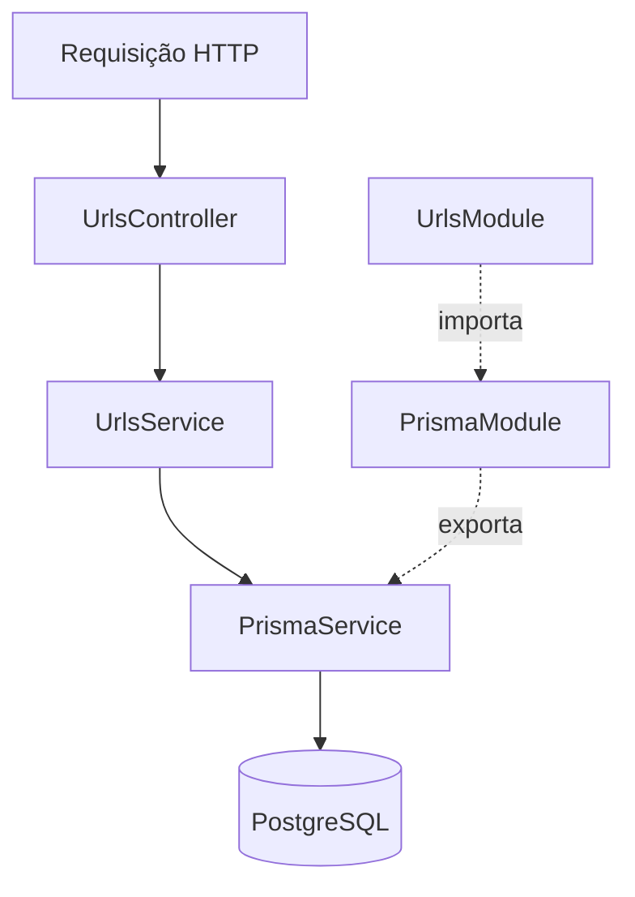

# Arquitetura

**Monólito modular, organizado por funcionalidade.** Sem Repository Pattern genérico, CQRS, microsserviços ou camada de infraestrutura artificial no MVP.

## Estrutura de `src/`

```text
src/
├── common/              # Peças compartilhadas / globais
│   ├── constants/       # Constantes usadas por mais de um arquivo, um arquivo por assunto (*.constants.ts)
│   ├── decorators/      # @SkipResponseEnvelope(), @ApiDataResponse(), @ApiProblemResponse()
│   ├── filters/         # ProblemDetailsFilter (RFC 9457) + RequestValidationException
│   ├── interceptors/    # ResponseEnvelopeInterceptor { data }
│   ├── interfaces/      # Todas as interfaces/tipos exportados, um por arquivo (*.interface.ts)
│   ├── pipes/           # ShortCodePipe (formato do :code)
│   └── utils/           # Funções puras (ex.: generateShortCode), com spec ao lado
├── config/              # configuration.ts, env.validation.ts, swagger.ts, throttler.ts
├── i18n/                # traduções: pt-BR (padrão) e en — common, validation, errors, entities
├── generated/prisma/    # Prisma Client gerado — não editar
├── modules/
│   ├── prisma/          # PrismaModule + PrismaService
│   ├── urls/            # Regras do encurtador
│   └── health/          # GET /health: app + PostgreSQL (sem envelope)
├── app.module.ts
└── main.ts
```

Pastas só são criadas quando têm conteúdo. Opcional em `common/` (somente se necessário): `guards/`.

| Pasta                | Regra                                                                                                                                                                                                                                             | Arquivos                                                                                                               |
| -------------------- | ------------------------------------------------------------------------------------------------------------------------------------------------------------------------------------------------------------------------------------------------- | ---------------------------------------------------------------------------------------------------------------------- |
| `common/constants/`  | Constantes usadas por **mais de um arquivo de `src/`**, agrupadas por assunto. Uma constante usada por um só arquivo fica nele (exportada se algum teste precisar dela, ex.: `MAX_URL_LENGTH` em `create-url.dto.ts`); testes não contam como uso | `short-code`, `throttle`, `http`, `i18n`, `swagger`, `environment`                                                     |
| `common/interfaces/` | Toda interface/tipo **exportado**, **um por arquivo**, nomeado pelo contrato                                                                                                                                                                      | `api-response`, `api-data-response-options`, `app-config`, `environment-variables`, `health-status`, `problem-details` |
| `common/utils/`      | Funções utilitárias puras, com o `*.spec.ts` ao lado                                                                                                                                                                                              | `generate-short-code`                                                                                                  |
| `common/pipes/`      | Pipes de parâmetros, com o `*.spec.ts` ao lado                                                                                                                                                                                                    | `short-code`                                                                                                           |

Usamos o `ValidationPipe` nativo, registrado como `APP_PIPE`.

## Fluxo de uma requisição



- **Controller**: rotas, parâmetros e códigos HTTP; chama o service.
- **Service**: regras de criar, buscar, atualizar, excluir e contar acessos. Acessa o banco diretamente pelo `PrismaService` (sem `urls.repository.ts`).
- **`PrismaModule`**: registra (`providers`) e exporta (`exports`) o `PrismaService`; não tem controller.
- **`PrismaService`**: estende o `PrismaClient` (driver adapter `@prisma/adapter-pg`), conecta e valida com `SELECT 1` em `onModuleInit` e desconecta em `onModuleDestroy`. É importado pelo `AppModule` (a app não sobe sem banco) e pelo `UrlsModule`. `main.ts` chama `app.enableShutdownHooks()`.

### `src/modules/urls/`

Registrado no `AppModule`:

- `urls.module.ts`: importa `PrismaModule` e registra `UrlsController` e `UrlsService`;
- `urls.controller.ts`: `@Controller('shorten')` + `@ApiTags('URLs')` com as cinco rotas, status HTTP e documentação Swagger; o `:code` passa pelo `ShortCodePipe`;
- `urls.service.ts`: regras de negócio, acessando o banco pelo `PrismaService`:
  - `create`: `createManyAndReturn({ skipDuplicates: true })` (`ON CONFLICT DO NOTHING`); se o código sorteado já existe, volta vazio e tenta outro, até 5 vezes;
  - `findByCode`: `UPDATE ... SET access_count = access_count + 1 ... RETURNING` em uma única consulta (atômico e sem alterar `updated_at`);
  - `update` / `remove`: `updateManyAndReturn` / `deleteMany` pelo `shortCode`; resultado vazio (ou `count: 0`) vira `404`, sem `try/catch` de erros do Prisma;
  - `getStats`: só leitura, não conta acesso.

Peças de apoio, com testes unitários ao lado:

- `dto/create-url.dto.ts` e `dto/update-url.dto.ts`: `url` obrigatória, texto, `http`/`https` com protocolo, até 2048 caracteres e sem caracteres de controle (mensagens traduzidas); `UpdateUrlDto` estende `CreateUrlDto`;
- `dto/url-response.dto.ts` (`UrlResponseDto`) e `dto/url-stats-response.dto.ts` (`UrlStatsResponseDto`, com `accessCount`): `fromEntity()` converte o model do Prisma, com `id` UUIDv7 e datas em ISO 8601;
- `common/pipes/short-code.pipe.ts` (`ShortCodePipe`): aceita só base62 com 1 a 12 caracteres (`SHORT_CODE_PATTERN`); fora disso lança `404` traduzido sem consultar o banco;
- `generateShortCode(length = 6)` (`common/utils/generate-short-code.ts`): base62 com `crypto.randomInt`, de 1 a 12 caracteres (o limite da coluna); o alfabeto e os tamanhos ficam no próprio arquivo.

Testes: `urls.service.spec.ts` (unitário, Prisma mockado) e `test/integration/urls.int-spec.ts` (PostgreSQL real, incluindo 25 acessos concorrentes).

| Arquivo / pasta      | Responsabilidade                                                                    |
| -------------------- | ----------------------------------------------------------------------------------- |
| `urls.controller.ts` | Rotas, parâmetros e códigos HTTP                                                    |
| `urls.service.ts`    | Regras de negócio                                                                   |
| `urls.module.ts`     | Registra controller, service e importa `PrismaModule`                               |
| `dto/`               | Entrada de `POST`/`PUT` e respostas (`*-response.dto.ts`) com os schemas do Swagger |
| `*.spec.ts`          | Testes unitários ao lado do código                                                  |

## Fluxo das respostas

- Sucesso JSON: o controller retorna o recurso; o interceptor aplica `{ "data": recurso }`.
- Exceção: o exception filter produz `application/problem+json` (RFC 9457).
- `204 No Content`: sem corpo e sem envelope.
- Swagger e health checks podem dispensar o envelope (`@SkipResponseEnvelope()`).
- Uma resposta já estruturada como `{ data, meta }` não deve virar `{ data: { data, meta } }`.

Pipe, guard, interceptor e filtro são registrados no `AppModule` como `APP_PIPE`, `APP_GUARD` (`ThrottlerGuard`), `APP_INTERCEPTOR` e `APP_FILTER`. Assim valem igual na app e nos testes E2E, que criam a app a partir do `AppModule`.

| Peça                                | Comportamento                                                                                                                                                                                                                                                                                                                                                                                                                                                                                                                                                                                                                                                                       |
| ----------------------------------- | ----------------------------------------------------------------------------------------------------------------------------------------------------------------------------------------------------------------------------------------------------------------------------------------------------------------------------------------------------------------------------------------------------------------------------------------------------------------------------------------------------------------------------------------------------------------------------------------------------------------------------------------------------------------------------------- |
| `ResponseEnvelopeInterceptor`       | Envolve em `{ data }`. Não envolve `undefined` (204), `StreamableFile`, objetos que já são `{ data }`/`{ data, meta }` (só essas chaves), rotas com `@SkipResponseEnvelope()` nem contextos que não são HTTP                                                                                                                                                                                                                                                                                                                                                                                                                                                                        |
| `ValidationPipe`                    | `whitelist`, `forbidNonWhitelisted`, `transform`; os erros viram `RequestValidationException` com os `ValidationError` originais                                                                                                                                                                                                                                                                                                                                                                                                                                                                                                                                                    |
| `ProblemDetailsFilter` (`@Catch()`) | Responde `application/problem+json` com `type: about:blank`, `title` (status HTTP traduzido), `status`, `detail` e `instance` (caminho da requisição). Em validação, adiciona `errors: [{ field, messages }]`. Erros 5xx são registrados no log. Erros 4xx do Express (pacote `http-errors`, com `expose: true`, ex.: `413` de corpo grande) mantêm o status e usam `common.CLIENT_ERROR.<status>` quando existe. Outros erros inesperados (que não são `HttpException`) expõem só uma mensagem genérica; `HttpException` lançadas de propósito (ex.: 503 do health) mantêm a mensagem. Mensagens padrão sem texto próprio (ex.: `new NotFoundException()`) usam o título traduzido |
| `ThrottlerGuard`                    | Rate limit por IP (`THROTTLE_LIMIT` a cada `THROTTLE_TTL` s), em memória. Acima do limite, lança `429` com a chave `common.TOO_MANY_REQUESTS`, que o filtro traduz. `/health` usa `@SkipThrottle()`. Ver [ADR 0004](adr/0004-limites-de-abuso.md)                                                                                                                                                                                                                                                                                                                                                                                                                                   |
| Swagger                             | `@ApiDataResponse({ type })` documenta o envelope; `@ApiProblemResponse(status, descrição)` documenta o `application/problem+json` (o interceptor não altera o OpenAPI sozinho)                                                                                                                                                                                                                                                                                                                                                                                                                                                                                                     |

## Internacionalização (i18n)

- [`nestjs-i18n`](https://nestjs-i18n.com/) com arquivos JSON em `src/i18n/<idioma>/<namespace>.json`, copiados para o `dist/` pelo `nest-cli.json` (`assets`).
- Idiomas: **pt-BR (padrão)** e **en**. Ordem de resolução: `?lang=en` → header `Accept-Language` → pt-BR. `en-*` cai em `en`, e `pt`/`pt-*` caem em `pt-BR`.
- O que é traduzido: mensagens de validação dos DTOs, os erros de negócio (ex.: `errors.NOT_FOUND` + `entities.URL`) e o `title`/`detail` do Problem Details. O Swagger continua em português.
- Como usar:
  - **DTO:** `@IsUrl(..., { message: i18nValidationMessage('validation.URL_INVALID') })`. Argumentos extras viram variáveis da tradução: `i18nValidationMessage('validation.URL_TOO_LONG', { max: MAX_URL_LENGTH })` preenche `{max}`.
  - **Exceção:** traduza no momento do `throw` com o `I18nService` injetado. O `t()` usa o idioma da requisição atual:

    ```ts
    throw new NotFoundException(
      this.i18n.t('errors.NOT_FOUND', {
        args: { entity: this.i18n.t('entities.URL') },
      }),
    );
    ```

    Cada `throw` repete esse bloco com a chave do erro correspondente (ex.: `errors.GENERATION_FAILED` + `entities.SHORT_CODE` no `create`), sem classes de exceção nem métodos auxiliares. Mensagens genéricas ficam em `errors` com `{entity}`; nomes de entidade ficam em `entities`. O filtro mantém mensagens já traduzidas e ainda traduz as que vierem no formato `namespace.CHAVE`.

  - **Nova chave:** adicione em **todos** os idiomas (`src/i18n/pt-BR` e `src/i18n/en`).

## Imports

| Alias    | Aponta para | Onde usar                                                                   |
| -------- | ----------- | --------------------------------------------------------------------------- |
| `@/`     | `src/`      | Todo import interno do código e dos testes, inclusive dentro da mesma pasta |
| `@test/` | `test/`     | Helpers de teste (`@test/support/...`)                                      |

- Os aliases ficam no `tsconfig.json` (`paths`) e no `vitest.config.mts` (`resolve.alias`). O `nest build` reescreve o `@/` no `dist/`.
- Sem caminhos relativos (`./`, `../`). A única exceção são os scripts `.mjs` de `test/support/setup/` executados direto pelo Node (`prepare-test-dbs.mjs`, `run-test-suite.mjs`), que não conhecem os aliases.
- A ordem é aplicada pelo Oxfmt (`sortImports`): módulos do Node → pacotes externos → `@/` e `@test/`, em ordem alfabética. Use `import type` quando o import for só de tipos.

```typescript
import { Injectable } from '@nestjs/common';
import { I18nService } from 'nestjs-i18n';
import { PrismaService } from '@/modules/prisma/prisma.service';
import { UrlResponseDto } from '@/modules/urls/dto/url-response.dto';
```

O `import` traz o símbolo; o `constructor(private readonly prisma: PrismaService)` pede a instância ao NestJS, em vez de `new PrismaService()`.
