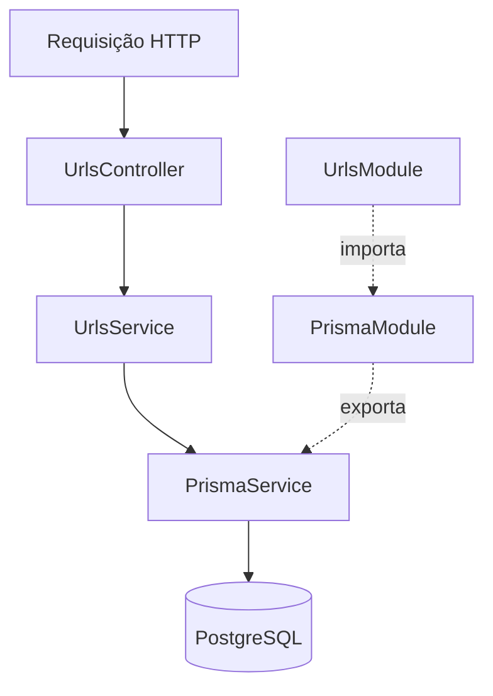

# Arquitetura

**Monólito modular, organizado por funcionalidade.** Sem Repository Pattern genérico, CQRS, microsserviços ou camada de infraestrutura artificial no MVP.

## Estrutura de `src/`

```text
src/
├── common/              # Peças compartilhadas / globais (sem regra de negócio)
│   ├── decorators/      # @SkipResponseEnvelope()             (v0.4.0)
│   ├── filters/         # ProblemDetailsFilter (RFC 9457)      (v0.4.0)
│   ├── interceptors/    # ResponseEnvelopeInterceptor { data } (v0.4.0)
│   └── interfaces/      # ApiResponse<T>                       (v0.4.0)
├── config/              # configuration.ts, env.validation.ts, swagger.ts
├── generated/prisma/    # Prisma Client gerado — não editar   (v0.2.0)
├── modules/
│   ├── prisma/          # PrismaModule + PrismaService         (v0.2.0)
│   ├── urls/            # Regras do encurtador                 (v0.3.0)
│   └── health/          # Opcional
├── app.module.ts
└── main.ts
```

Pastas só são criadas quando têm conteúdo. Opcionais em `common/` (somente se necessário): `guards/`, `pipes/`, `utils/`. Usamos o `ValidationPipe` nativo.

## Fluxo de uma requisição



- **Controller**: rotas, parâmetros e códigos HTTP; chama o service.
- **Service**: regras de criar, buscar, atualizar, excluir e contar acessos. Acessa o banco diretamente pelo `PrismaService` (sem `urls.repository.ts`).
- **`PrismaModule`**: registra (`providers`) e exporta (`exports`) o `PrismaService`; não tem controller.
- **`PrismaService`**: estende o `PrismaClient` (driver adapter `@prisma/adapter-pg`), conecta em `onModuleInit` e desconecta em `onModuleDestroy`. `main.ts` chama `app.enableShutdownHooks()`.

### `src/modules/urls/`

| Arquivo / pasta      | Responsabilidade                                       |
| -------------------- | ------------------------------------------------------ |
| `urls.controller.ts` | Rotas, parâmetros e códigos HTTP                       |
| `urls.service.ts`    | Regras de negócio                                      |
| `urls.module.ts`     | Registra controller, service e importa `PrismaModule`  |
| `dto/`               | Validação de entrada de `POST` e `PUT`                 |
| `responses/`         | Representação pública e schemas de resposta do Swagger |
| `utils/`             | Geração de códigos curtos (com testes ao lado)         |
| `*.spec.ts`          | Testes unitários ao lado do código                     |

## Fluxo das respostas

- Sucesso JSON: o controller retorna o recurso; o interceptor aplica `{ "data": recurso }`.
- Exceção: o exception filter produz `application/problem+json` (RFC 9457).
- `204 No Content`: sem corpo e sem envelope.
- Swagger e health checks podem dispensar o envelope (`@SkipResponseEnvelope()`).
- Uma resposta já estruturada como `{ data, meta }` não deve virar `{ data: { data, meta } }`.

## Imports

Alias `@/` → `src/` (configurado em `tsconfig.json`; o `nest build` reescreve o alias no `dist/` e o Vitest resolve via `resolve.alias`).

```typescript
import { PrismaService } from '@/modules/prisma/prisma.service';
```

O `import` traz o símbolo; o `constructor(private readonly prisma: PrismaService)` pede a instância ao NestJS, em vez de `new PrismaService()`.
