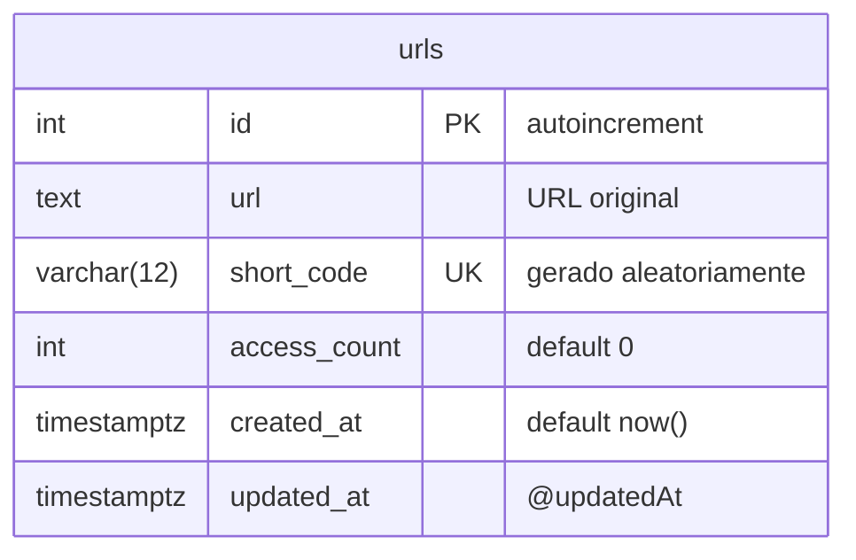

# Modelo de dados

A única tabela **de negócio** do MVP é `urls` (além da técnica `_prisma_migrations`).



| Campo Prisma/API | Coluna SQL     | Observação                             |
| ---------------- | -------------- | -------------------------------------- |
| `id`             | `id`           | Chave primária; string no JSON público |
| `url`            | `url`          | URL original, `text`                   |
| `shortCode`      | `short_code`   | Único, gerado aleatoriamente           |
| `accessCount`    | `access_count` | Começa em 0                            |
| `createdAt`      | `created_at`   | Timestamp de criação                   |
| `updatedAt`      | `updated_at`   | Timestamp de atualização               |

```prisma
model Url {
  id          Int      @id @default(autoincrement())
  url         String   @db.Text
  shortCode   String   @unique @map("short_code") @db.VarChar(12)
  accessCount Int      @default(0) @map("access_count")
  createdAt   DateTime @default(now()) @map("created_at") @db.Timestamptz(6)
  updatedAt   DateTime @updatedAt @map("updated_at") @db.Timestamptz(6)

  @@map("urls")
}
```

## Migrations

- **Prisma Migrate** é o único mecanismo de migrations do repositório.
- Migration inicial: `prisma/migrations/20261019183145_create_urls_table/migration.sql` (tabela `urls`, `urls_pkey` e índice único `urls_short_code_key`).
- Criar uma nova: `pnpm db:migrate --name <nome>`. Aplicar em outro banco: `pnpm db:migrate:deploy`.
- Não há `UP`/`DOWN` simétrico: para desfazer em ambientes compartilhados, criar uma migration corretiva.
- O incremento de `access_count` deve ser **atômico** (`{ increment: 1 }`).
