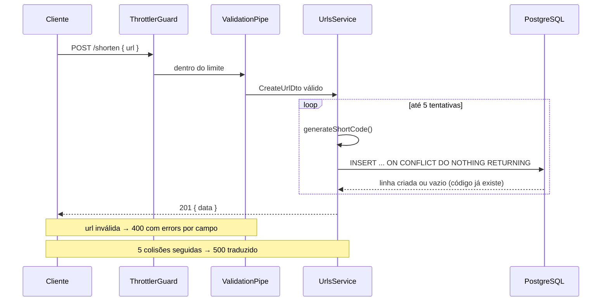
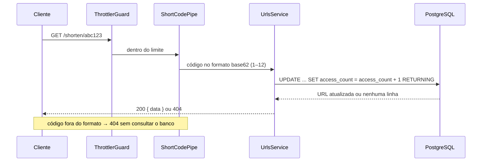
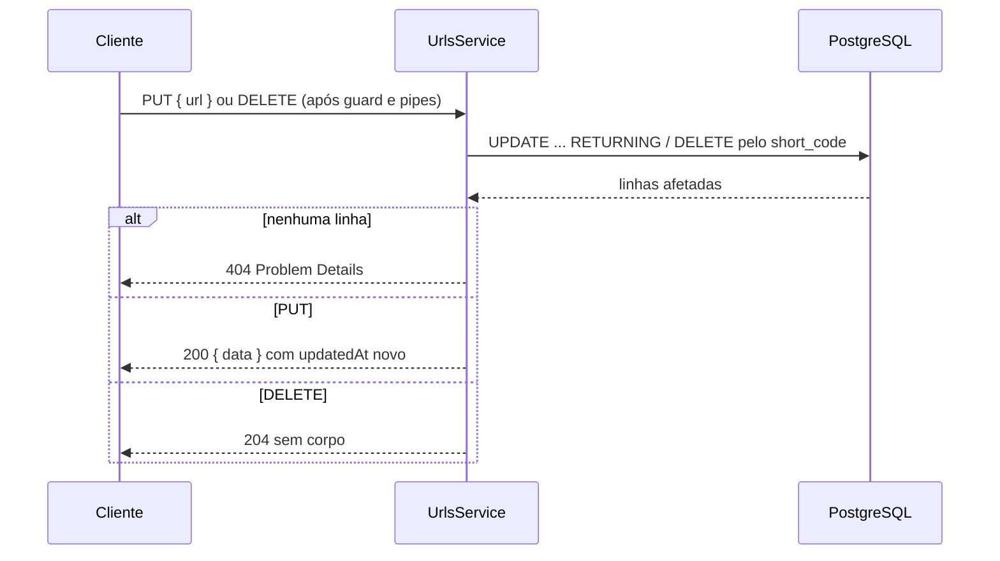
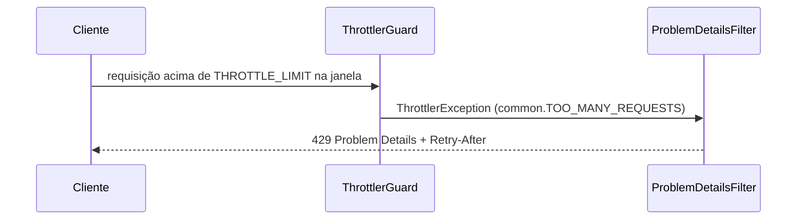

# Diagramas de sequência

Fluxos principais da API. Toda requisição às rotas `/shorten` passa antes pelo `ThrottlerGuard` (rate limit por IP); erros em qualquer etapa viram Problem Details no `ProblemDetailsFilter`.

## Encurtar uma URL — `POST /shorten`

## Recuperar e contar acesso — `GET /shorten/:code`

O incremento é atômico porque acontece em uma única consulta. `GET /shorten/:code/stats` só lê (`SELECT`) e não conta acesso.

## Atualizar ou excluir — `PUT` / `DELETE /shorten/:code`

## Rate limit

