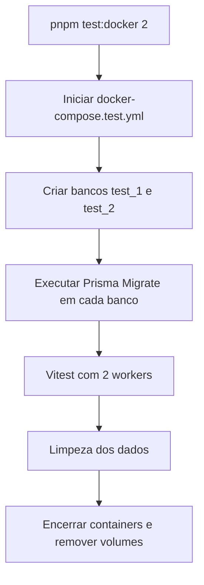

# Testes

| Tipo       | Local                               | Docker? | Finalidade                                                      |
| ---------- | ----------------------------------- | ------- | --------------------------------------------------------------- |
| Unitário   | `src/**/*.spec.ts`                  | Não     | Regras do service, gerador de códigos e mocks                   |
| Integração | `test/integration/**/*.int-spec.ts` | Sim     | Prisma real, constraints, migrations e operações no banco       |
| E2E        | `test/e2e/**/*.e2e-spec.ts`         | Sim     | API HTTP real, status, contratos, validação e dados persistidos |

## Comandos

Disponíveis agora:

```bash
pnpm test               # todos os projetos
pnpm test:unit
pnpm test:unit:watch
pnpm test:cov
pnpm test:integration   # sem Docker por enquanto; passa sem testes
pnpm test:e2e           # sem Docker por enquanto; passa sem testes
```

Planejados (URL-20, v0.5.0):

```bash
pnpm test:docker                 # integração + E2E, até 4 workers
pnpm test:docker 1               # 1 worker
pnpm test:integration:docker 2
pnpm test:e2e:docker 1
```

## Estrutura

Um único `vitest.config.mts` com [projetos](https://vitest.dev/guide/projects) (`test.projects`):

| Projeto       | Arquivos                            | Script                  |
| ------------- | ----------------------------------- | ----------------------- |
| `unit`        | `src/**/*.spec.ts`                  | `pnpm test:unit`        |
| `integration` | `test/integration/**/*.int-spec.ts` | `pnpm test:integration` |
| `e2e`         | `test/e2e/**/*.e2e-spec.ts`         | `pnpm test:e2e`         |

- Plugin SWC, alias `@`, `environment: 'node'` e `maxWorkers: 4` ficam na raiz e são herdados pelos projetos (`extends: true` é o padrão no Vitest 5).
- `coverage` só pode ser configurado na raiz.
- Rodar um projeto: `pnpm vitest --project unit`; excluir: `--project '!e2e'`.
- `--passWithNoTests` está só em `test:integration` e `test:e2e`; o `unit` falha se não encontrar testes.

```text
test/
├── integration/
├── e2e/
└── support/
    ├── database/    # cleanup.ts
    ├── factories/   # url.factory.ts
    ├── helpers/     # create-test-app.ts
    └── setup/       # prepare-test-dbs.mjs, worker-database.ts, run-test-suite.mjs
```

- Use **no máximo 4 workers** (definido em `vitest.config.mts`).
- Vitest usa `unplugin-swc` para emitir metadados de decorators (DI do NestJS).
- `fixtures/` e `mocks/` em `test/support/` são criadas quando necessárias.
- Banco de testes por worker e `docker-compose.test.yml`: URL-12 (v0.2.0). Runners Docker: URL-20 (v0.5.0).

## Fluxo de integração e E2E _(URL-12 / URL-20)_



### Isolamento

- Docker de testes separado do de desenvolvimento.
- 1 a 4 workers (4 por padrão); cada worker tem seu próprio banco.
- `test/support/setup/prepare-test-dbs.mjs` prepara bancos e aplica migrations.
- O runner verifica `NODE_ENV=test` e recusa limpar bancos de desenvolvimento/produção.
- Dados são limpos **entre testes do mesmo worker**.
- Containers e volumes são encerrados mesmo quando os testes falham.
- Mesma estratégia localmente e no GitHub Actions.

## Critérios mínimos por endpoint

| Endpoint                   | Testes mínimos                                        |
| -------------------------- | ----------------------------------------------------- |
| `POST /shorten`            | URL válida/inválida, 201/400, código único e colisões |
| `GET /shorten/:code`       | Existe/não existe, 200/404 e política de contagem     |
| `PUT /shorten/:code`       | Atualização válida/inválida, timestamps, 200/400/404  |
| `DELETE /shorten/:code`    | Remover, 204 sem corpo, 404                           |
| `GET /shorten/:code/stats` | `accessCount`, 200/404, sem incremento acidental      |

Também testar envelope `{ data }`, erros RFC 9457, `ValidationPipe`, URLs do Swagger e migrations em banco limpo.
