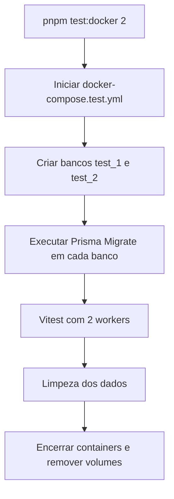

# Testes

| Tipo       | Local                               | Docker? | Finalidade                                                      |
| ---------- | ----------------------------------- | ------- | --------------------------------------------------------------- |
| Unitário   | `src/**/*.spec.ts`                  | Não     | Regras do service, gerador de códigos e mocks                   |
| Integração | `test/integration/**/*.int-spec.ts` | Sim     | Prisma real, constraints, migrations e operações no banco       |
| E2E        | `test/e2e/**/*.e2e-spec.ts`         | Sim     | API HTTP real, status, contratos, validação e dados persistidos |

## Comandos

```bash
pnpm test:unit                    # unitários, sem Docker
pnpm test:unit:watch
pnpm test:cov                     # cobertura dos unitários
pnpm test:docker                  # integração + E2E com Docker, 4 workers
pnpm test:docker 2                # 2 workers (1 a 4)
pnpm test:integration:docker 2    # só integração
pnpm test:e2e:docker 1            # só E2E
pnpm test:docker 2 -t "shortCode" # argumentos extras vão para o Vitest
```

O `test:docker` (`test/support/setup/run-test-suite.mjs`):

1. cria o `.env.test` a partir do `.env.test.example`, se ele não existir;
2. sobe o `docker-compose.test.yml` e espera o healthcheck;
3. cria `url_shortener_test_1..N` e aplica as migrations (`prepare-test-dbs.mjs N`);
4. roda o Vitest com `--maxWorkers N`, então cada worker tem o seu banco;
5. executa `docker compose down -v` **sempre**: com sucesso, com falha nos testes ou com Ctrl+C/SIGTERM (exit 130/143);
6. sai com o código do Vitest.

Passo a passo manual, para depurar com o banco de pé:

```bash
pnpm db:test:up
pnpm db:test:prepare 4
pnpm test:integration             # ou: pnpm vitest --project integration --maxWorkers 2 (com 2 bancos)
pnpm db:test:down
```

> No modo manual, prepare tantos bancos quanto workers (o Vitest usa até 4).

## Estrutura

Um único `vitest.config.mts` com [projetos](https://vitest.dev/guide/projects) (`test.projects`):

| Projeto       | Arquivos                            | Script                  |
| ------------- | ----------------------------------- | ----------------------- |
| `unit`        | `src/**/*.spec.ts`                  | `pnpm test:unit`        |
| `integration` | `test/integration/**/*.int-spec.ts` | `pnpm test:integration` |
| `e2e`         | `test/e2e/**/*.e2e-spec.ts`         | `pnpm test:e2e`         |

- Plugin SWC, alias `@`, `environment: 'node'` e `maxWorkers: 4` ficam na raiz e são herdados pelos projetos (`extends: true` é o padrão no Vitest 5).
- `coverage` só pode ser configurado na raiz.
- Rodar um projeto: `pnpm vitest --project unit`; excluir: `--project '!e2e'`.
- `--passWithNoTests` está só em `test:e2e`; `unit` e `integration` falham se não encontrarem testes.
- `integration` e `e2e` usam `setupFiles: ['./test/support/setup/worker-database.ts']`.

```text
test/
├── integration/
│   ├── migrations.int-spec.ts      # migration aplicada, colunas, defaults, UNIQUE, limpeza
│   └── test-database.int-spec.ts   # guarda contra banco que não é de teste
├── e2e/
│   └── urls.e2e-spec.ts            # HTTP real: envelope, 204, Problem Details, i18n pt-BR/en
└── support/
    ├── database/
    │   ├── client.ts               # createTestPrismaClient()
    │   └── cleanup.ts              # truncateAllTables(prisma)
    ├── factories/                  # url.factory.ts (v0.3.0)
    ├── helpers/
    │   └── create-test-app.ts      # app a partir do AppModule (mesmo pipe/interceptor/filtro)
    └── setup/
        ├── test-database.mjs       # guarda, .env.test e URL por worker
        ├── prepare-test-dbs.mjs    # cria 1–4 bancos e aplica migrations
        ├── run-test-suite.mjs      # runner do test:docker (up → prepare → vitest → down)
        └── worker-database.ts      # setupFile: DATABASE_URL = <base>_<VITEST_POOL_ID>
```

| Peça                      | Como funciona                                                                                                                                               |
| ------------------------- | ----------------------------------------------------------------------------------------------------------------------------------------------------------- |
| `docker-compose.test.yml` | Projeto `url-shortener-test`, separado do dev; porta `${POSTGRES_PORT:-5433}`; dados em `tmpfs`; `fsync`/`synchronous_commit`/`full_page_writes` desligados |
| Banco por worker          | A `DATABASE_URL` do `.env.test` é a base (`url_shortener_test`); cada worker usa `url_shortener_test_<VITEST_POOL_ID>`                                      |
| Guarda                    | Exige `NODE_ENV=test` e banco com nome terminado em `_test` ou `_test_N`; vale no prepare, no setup dos workers, no client e na limpeza                     |
| Limpeza                   | `truncateAllTables` faz `TRUNCATE ... RESTART IDENTITY CASCADE` em todas as tabelas, exceto `_prisma_migrations`; chame no `beforeEach`                     |
| Teardown                  | Automático no `test:docker` (inclusive em falha/sinal); manual com `pnpm db:test:down` (`down -v`)                                                          |

- Use **no máximo 4 workers** (definido em `vitest.config.mts`).
- Vitest usa `unplugin-swc` para emitir metadados de decorators (DI do NestJS).
- `fixtures/` e `mocks/` em `test/support/` são criadas quando necessárias.

## Fluxo de integração e E2E



### Isolamento

- Docker de testes separado do de desenvolvimento.
- 1 a 4 workers (4 por padrão); cada worker tem seu próprio banco.
- `test/support/setup/prepare-test-dbs.mjs` prepara bancos e aplica migrations.
- O runner define `NODE_ENV=test`, e a guarda recusa bancos de desenvolvimento/produção.
- Dados são limpos **entre testes do mesmo worker**.
- Containers e volumes são encerrados mesmo quando os testes falham.
- Mesma estratégia localmente e no GitHub Actions.

## Critérios mínimos por endpoint

| Endpoint                   | Testes mínimos                                        |
| -------------------------- | ----------------------------------------------------- |
| `POST /shorten`            | URL válida/inválida, 201/400, código único e colisões |
| `GET /shorten/:code`       | Existe/não existe, 200/404 e política de contagem     |
| `PUT /shorten/:code`       | Atualização válida/inválida, timestamps, 200/400/404  |
| `DELETE /shorten/:code`    | Remover, 204 sem corpo, 404                           |
| `GET /shorten/:code/stats` | `accessCount`, 200/404, sem incremento acidental      |

Também testar envelope `{ data }`, erros RFC 9457, `ValidationPipe`, URLs do Swagger e migrations em banco limpo.
